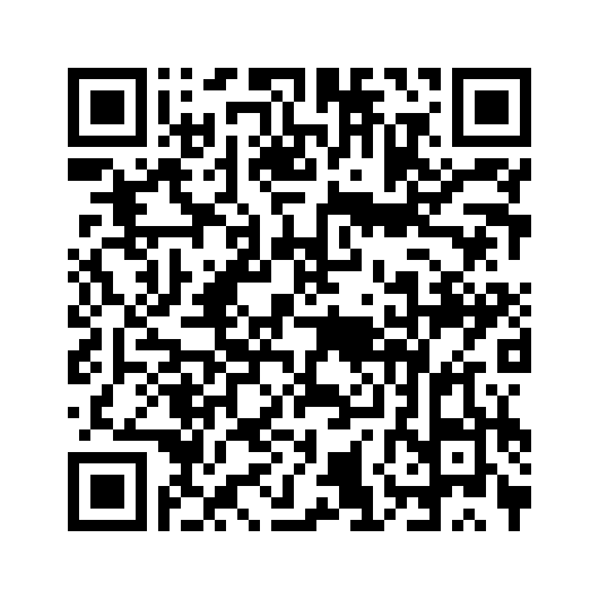

# LauncherUpdater_Zelda_Dungeons-Of_Infinity_3DS_Port

Lanceur Nintendo 3DS pour le port de Dungeons of Infinity and Beyond par Dan Franza : https://github.com/DanFranza/The-Legend-of-Zelda-Dungeons-of-Infinity-and-Beyond-3DS/tree/3DS-port

Les fichiers `doi-launcher.3dsx` et `doi-launcher.cia` sont ceux du **lanceur**. Copier le 3DSX dans `sd:/3ds/DoiLauncher/` pour Homebrew Launcher, ou installer le CIA avec FBI.

## Installer le lanceur avec FBI

Sur la 3DS connectée au Wi-Fi, ouvrir **FBI → Remote Install → Scan QR Code**, puis viser le code ci-dessous. Confirmer l’installation du CIA dans FBI. Le code pointe vers le [CIA du lanceur](https://raw.githubusercontent.com/DanFranza/LauncherUpdater_Zelda_Dungeons-Of_Infinity_3DS_Port/main/doi-launcher.cia), pas vers le jeu.

SHA-256 du CIA v1.0.2 : `dfad3223016ce9d7abdc45f274fb59612a23354f2b33e17a311e3921b5b8e352`.

L’écran supérieur reprend le décor et les sprites de l’écran titre du port 3DS, sans texte rogné dans le coin inférieur droit. La mention « Port 3DS de Dan Franza » devient « 3DS Port by Dan Franza » en anglais.

Le menu « Installer le jeu → 3DSX » télécharge `doi3ds.3dsx` dans `sd:/3ds/`, contrôle sa taille et son empreinte Git, puis conserve la version précédente en secours. « Jouer » lance le 3DSX par le chargeur homebrew Luma3DS. Les sauvegardes du jeu ne sont pas touchées.

La branche ne publie pas encore de CIA du jeu. Le menu CIA signale cette absence. Si `doi3ds.cia` apparaît à la racine de `3DS-port`, le lanceur pourra le télécharger dans `sd:/3ds/` et le vérifier. Il faudra l'installer ensuite avec FBI : l'identifiant du titre CIA du jeu n'est pas encore connu.

Compilation : devkitPro, libctru, citro2d, citro3d, curl et mbedTLS pour 3DS ; définir `NETWORK_PREFIX` vers les bibliothèques réseau, puis `./tools/build.sh`. Pour le CIA, utiliser `MAKEROM=/chemin/makerom ./tools/build.sh --cia`.

Code adapté du lanceur PokéSurvivor 3DS de Dan Franza, sous licence PolyForm Noncommercial 1.0.0. Les licences des composants tiers sont dans `licenses/`. L'interface et l'icône ont été redessinées sans sprite Pokémon. L'écran titre emploie les ressources graphiques du port 3DS cité ci-dessus. Compilation 3DSX et CIA réussie ; fonctionnement sur console physique à vérifier.
